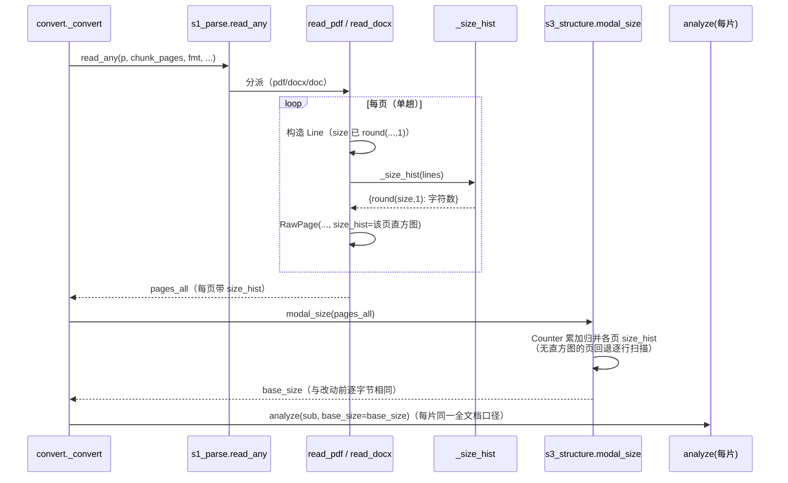
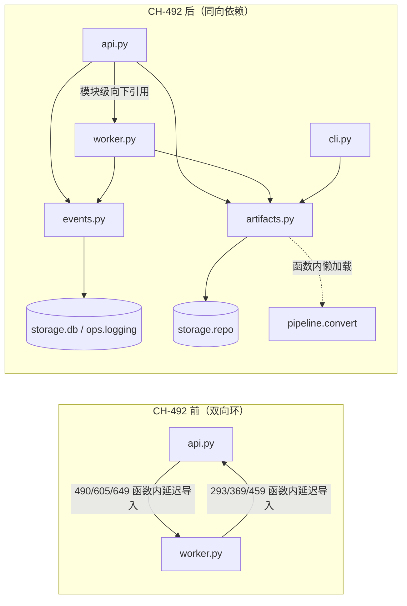
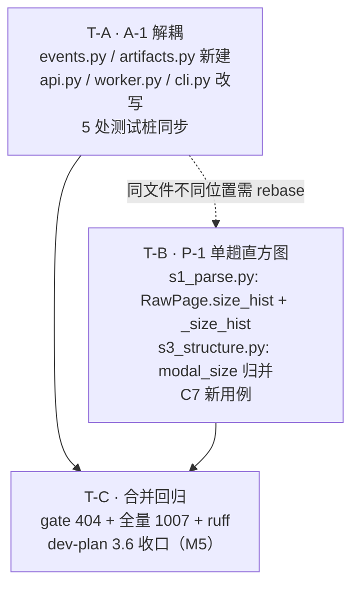

# Doc2md CH-492 实施规格：P-1 单趟字号直方图 + A-1 api↔worker 双向依赖解耦

> 撰写人：高见远（Gao）· 架构师 · 承接 CH-491 第十三轮审查（`docs/review-round13-CH-491.md` §3 P-1 / A-1、§4 T4）
> 性质：**只读审查产出的实施规格**。本文件未修改任何源码或既有文档；唯一新建文件即本文件。
> 编号：本轮变更自 **CH-492** 起。

---

## 0. 总览与复核结论

### 0.1 两项规格一句话

| 项 | 方案 | 改动面 | 字节风险 |
| --- | --- | --- | --- |
| **P-1** | S1 单趟累计字号直方图（`RawPage.size_hist`），`modal_size` 改为直方图归并 + 无直方图回退逐行扫描 | 2 个管线文件 + 1 条建议新增用例 | 有（已论证并实测等价，见 §1.4） |
| **A-1** | 抽中立模块 `doc2md/events.py`（事件发射）与 `doc2md/artifacts.py`（产物重建/孤儿清理/IR 回读），api 与 worker 同向依赖 | 2 个新文件 + api/worker/cli 3 个源码文件 + 5 个测试文件 | 零（纯搬迁，函数体逐字不动） |

### 0.2 复核结论（对 CH-491 原方案的两处修正/收紧）

1. **P-1：方案可行，但原报告有两个未写明的必要条件，本规格补齐**：
   - ① **回退路径必须有**。`tests/test_ch471_fixes.py:57-60` 等用例手工构造 `RawPage`（无直方图）后直接调 `modal_size`，若 `modal_size` 只读直方图，这些用例会静默拿到 `10.0` 而失败。规格给出「有直方图归并、无直方图逐行扫描」双路径，且证明两路径输出逐字节相同（§1.4，5000 例随机 + 平票构造实测 0 不符）。
   - ② **归并必须是累加，不是 `dict.update`**。本规格撰写过程中的验证 harness 曾误用 `dict.update` 归并，3000 例中 1122 例与单遍 `Counter` 不符——`dict.update` 是**覆盖**语义，会把前页计数冲掉；正确写法是 `Counter.update`（或显式 `+=`）。这是本规格最重要的单点陷阱，已写成代码注释（§1.5 C5）。
   - ③ 附带确认：`convert.py` **零改动**——`convert.py:174` 的 `modal_size(pages_all)` 调用点与 CH-471（PIPE-1）「全文档口径」纪律原样保留，快速路径自动生效。
2. **A-1：方案可行，一处与团队下达口径的差异已按更严口径处理**：CH-491 报告写「删除 5 处延迟 import」，即保留 `api.py:490` 的 `from .worker import enqueue_many`；本次任务验收口径要求 api.py / worker.py 内不再有跨文件延迟 import。本规格按更严口径执行：**6 处全删**，`enqueue_many` 改为 api.py **模块级**向下引用（`api` 入口层 → `worker` 编排层，符合 dev-plan.md 第三章的分层方向，且 refactor 后 worker 不再引用 api，环已断，模块级导入安全）。理由与取证见 §2.4.3。
3. **未发现「方案不可行 / 前提不成立」项**。两项均可按本规格落地。

### 0.3 行号锚点约定（重要）

本规格撰写时，工作区存在未提交改动（CH-491 B-1~B-6）且**工程师正在并行施工**（`git status` 显示 `doc2md/worker.py` 等 7 个文件已修改，worker.py 内已出现 CH-492/Q-3 的 `drain_once` 拆分）。因此：

- 文中所有 `文件:行号` 均为**撰写时快照**（HEAD=`cdea8b0` + 上述未提交改动）；
- **实施时一律以每条改动点给出的 grep 锚点（函数名 / 唯一代码串）定位**，行号仅用于快速跳转；
- 若锚点本身已不存在（被并行施工改掉），先与架构师确认再动手，不要猜测。

---

## 1. 规格一（P-1）：`modal_size` 单趟直方图

### 1.1 背景与目标

`doc2md/pipeline/convert.py:174` 调 `s3_structure.modal_size(pages_all)` 计算全文档正文字号众数 `base_size`；现实现（`s3_structure.py:847-861`）对全文档每一个 `Line` 执行 `round(ln.size, 1)` + `len(ln.text.strip())` + `Counter` 累加——这是 S1 之后的**第二次全文档逐行遍历**。而 `read_any`（`s1_parse.py:1021`）在构造每个 `Line` 时已经算过 `size`（PDF 路径的 `_line_style` 甚至已经 `round(...,1)`），同一批数据被遍历两遍。

目标：在 S1 构造 `Line` 的单趟内顺带累计字号直方图，`modal_size` 改为归并，省掉第二次遍历；**输出逐字节不变**（`base_size` 是「分片≡单片」判据根，`convert.py:170-174` CH-471/PIPE-1）。

### 1.2 现状取证

| 事实 | 证据 |
| --- | --- |
| `modal_size` 现实现 | `doc2md/pipeline/s3_structure.py:847-861`：`from collections import Counter`；`for p in pages: for ln in p.lines: if ln.size: c[round(ln.size, 1)] += max(1, len(ln.text.strip()))`；`return c.most_common(1)[0][0] if c else 10.0` |
| `modal_size` 全部调用方 | ① `doc2md/pipeline/convert.py:174`（生产路径，全文档口径）；② `doc2md/pipeline/s3_structure.py:492`（`analyze(pages, base_size=None)` 内部自算，服务直接调 `analyze` 的调用方/测试）；③ `tests/test_ch471_fixes.py:59-60,73`（手工构造页直接调） |
| S1 三条读取路径都构造 `RawPage` | `read_pdf`：`s1_parse.py:195` `out.append(RawPage(index=i, lines=lines, height=...))`；`read_docx`：`s1_parse.py:1004` `pages.append(RawPage(index=i, lines=lines[i*chunk:(i+1)*chunk]))`（合成页，`chunk = 40`，`:1002`）；旧版 `.doc` 经 `legacy_doc.read_legacy_doc` → `read_docx`（`legacy_doc.py:171,180`），**自动被覆盖** |
| `Line.size` 的口径 | PDF：`_line_style` 返回的 size 已 `round(...,1)`（`s1_parse.py:405`）；DOCX：`float(r.font.size.pt)` 或 `_style_size(style)`（`s1_parse.py:695,720`），**未取整**——所以直方图 key 必须统一做 `round(ln.size, 1)`（CH-485/R9-PIPE-2 的 0.1 精度纪律） |
| size 恒 0 的行 | DOCX 分页符行 `Line(text="\x0c", size=0.0)`（`s1_parse.py:985`）与 `w:tbl` 表格行（`s1_parse.py:989-991`，size 缺省 0.0）——被 `if ln.size:` 排除，直方图必须同口径排除 |
| `RawPage` 的所有构造点都用关键字参数 | `s1_parse.py:195,1004` + 测试中约 15 处（`test_ch471_fixes.py:26`、`test_s3_blocks.py:32`、`test_pdf_structure_repair.py:27` 等）；无 `dataclasses.replace`/`asdict` 作用于 `RawPage`（`replace` 只用于 `Line`，`s1_parse.py:840`）——**加带缺省值的字段是向后兼容的** |
| 性能红线设施 | `tests/test_perf_lowend.py` 共 **29 项**（本次 `--collect-only` 实测），全量收集无 `pytest-benchmark`（`pyproject.toml` dev 依赖仅 pytest/reportlab/pypdf/ruff）；`ops/bench/t6_large_corpus.py` 是语料级 CLI 吞吐 harness，不适合单文档微基准 |

### 1.3 方案设计

#### 1.3.1 数据结构

- `RawPage` 新增字段 `size_hist: dict[float, int]`（`field(default_factory=dict)`）：**每页一份**小直方图，key = `round(ln.size, 1)`，value = 该页内 `Σ max(1, len(ln.text.strip()))`。
- 选「每页一份」而非「整次读取一份共享 dict」的理由：① `RawPage` 是自描述数据模型，页被切片（`read_any` 的 `page_span` 分支、`read_docx` 的 `[lo:hi]` 切片）后直方图仍随页走、不会张冠李戴；② 归并逻辑简单；③ 典型文档每页只有 1~5 个字号键，320 页的内存开销可忽略（相对 `Line` 对象本身）。
- 不用 `Counter` 而用普通 `dict` 存每页直方图：构造处只做 `get/+`，不需要 `most_common`；归并处再进 `Counter`（保持终态选择原语不变）。

#### 1.3.2 累计点（单趟内，Line 构造处）

| 路径 | 位置 | 说明 |
| --- | --- | --- |
| PDF | `read_pdf` 页构造处（`s1_parse.py:195` 锚点） | 每页 `lines` 构造 + `_attach_links` 之后、`out.append` 之前，对**本页 lines** 调 `_size_hist(lines)`。仍在 S1 单趟内（lines 刚构造、缓存热），且 `chunk_pages > 0` 分块 open/close 时各块页都进同一个 `out`，跨块累计天然成立 |
| DOCX | `read_docx` 合成页处（`s1_parse.py:1004` 锚点） | 每个 40 行合成页切片后累计 |
| 旧版 .doc | 无需改动 | 经 `read_docx` 自动获得 |

不选「在 `_line_from_raw` / `_docx_para_line` 内累计」的理由：那需要把累加器穿透 `_lines_single_column` / `_extract_two_column` / `_docx_para_line` 三层签名，改动面与回归面都大于页构造处的一次小循环，且页构造处的循环与 `RawPage.chars` 属性（`s1_parse.py:89-91`）是同族写法，风格一致。

#### 1.3.3 归并逻辑（`modal_size`）

```
merged = Counter()
for p in pages:
    if p.size_hist:  merged.update(p.size_hist)      # 累加归并（快路径）
    else:            for ln in p.lines: <原逐行累加>  # 回退（手工构造的页）
return merged.most_common(1)[0][0] if merged else 10.0
```

### 1.4 字节一致性论证（本规格的核心安全论证）

`base_size` 的取值只取决于 `Counter.most_common(1)` 的结果；`most_common(1)` 等价于「按计数取最大，**平票时取插入序最前者**」（CPython `nlargest(n=1)` 走 `max()`，`max` 返回首个最大值；`sorted` 稳定）。因此只需证明：**归并后的 Counter 与单遍 Counter 在「键→计数」和「插入序」上完全相同**。

1. **计数相同**：每页直方图按页内行序累加，归并按页序累加，总和 = 单遍按 (页, 行) 序累加的值。同一 key 的增量序列相同。
2. **插入序相同**：单遍 Counter 的插入序 = 各 key 在文档行序中的**首次出现序**；归并时新 key 在「第一次被某页直方图引入」时插入 merged，页按文档序处理、页内按行序——同样是首次出现序。两者一致。
3. **平票判定因此一致**：计数相同 + 插入序相同 ⇒ `most_common(1)` 返回值相同。
4. **混合场景也安全**：若部分页有直方图、部分没有（生产不会发生，防御性路径），插入序仍是首次出现序，结论不变。
5. **边界**：空文档 / 全 size=0 文档 → merged 空 → 返回 `10.0`，与原实现 `if c else 10.0` 一致。

**实测验证**（隔离 venv，纯内存构造 `Line`/`RawPage`，无文件 I/O）：

| 验证 | 结果 |
| --- | --- |
| 5000 例随机文档（0~7 页、0~14 行/页、9 种字号含 0.0/10.5/22.0、文本长 0~11）：单遍 `Counter` vs 「每页直方图 + `Counter.update` 归并」 | **0 / 5000 不符** |
| 同上 vs 「每页直方图 + 显式 `+=` 归并」 | **0 / 5000 不符** |
| 强平票构造（5 页 × 2 行，三个字号计数全等） | 三者同值，先出现者胜 |
| 单页双字号平票 | 三者同值（14.0 先出现则胜） |
| 空文档 / 全零字号 | 三者均 `10.0` |
| **反证（陷阱实证）**：同一 harness 改用 `dict.update` 归并 | **1122 / 3000 不符**——`dict.update` 是覆盖语义，后页计数冲掉前页。**实施时严禁使用** |

### 1.5 改动点清单

#### C1. `doc2md/pipeline/s1_parse.py` — `RawPage` 增加 `size_hist` 字段

- 锚点：`class RawPage`（快照 `:84`）
- 改前：
```python
@dataclass
class RawPage:
    index: int                      # 0-based
    lines: list[Line] = field(default_factory=list)
    height: float = 0.0             # PDF 页高（pt）；DOCX / 合成页为 0（无几何）

    @property
    def chars(self) -> int:
        return sum(len(ln.text.strip()) for ln in self.lines)
```
- 改后：
```python
@dataclass
class RawPage:
    index: int                      # 0-based
    lines: list[Line] = field(default_factory=list)
    height: float = 0.0             # PDF 页高（pt）；DOCX / 合成页为 0（无几何）
    # CH-492（P-1）：S1 单趟累计的字号直方图 round(size,1) → 字符数，供
    # s3_structure.modal_size 归并，免去全文档第二次逐行遍历。手工构造的页
    # （测试 / 直接调用方）缺省为空 dict → modal_size 回退逐行扫描，行为不变。
    size_hist: dict[float, int] = field(default_factory=dict)

    @property
    def chars(self) -> int:
        return sum(len(ln.text.strip()) for ln in self.lines)
```

#### C2. `doc2md/pipeline/s1_parse.py` — 新增 `_size_hist` 辅助函数

- 位置：`RawPage` 类定义之后、`def sniff` 之前
- 内容：
```python
def _size_hist(lines: list[Line]) -> dict[float, int]:
    """CH-492（P-1）：单趟累计字号直方图。

    口径与 `s3_structure.modal_size` 的逐行累加**逐字节一致**——key 取
    `round(ln.size, 1)`（CH-485/R9-PIPE-2 的 0.1 精度纪律：10.5 不得被
    抬成 10.0），value 为 Σ max(1, len(ln.text.strip()))；`ln.size` 为 0
    的行不计入（DOCX 分页符行与 w:tbl 表格行 size 恒 0，与原 modal_size
    的 `if ln.size:` 同口径）。改此口径前先读 s3_structure.modal_size。
    """
    h: dict[float, int] = {}
    for ln in lines:
        if ln.size:
            k = round(ln.size, 1)
            h[k] = h.get(k, 0) + max(1, len(ln.text.strip()))
    return h
```

#### C3. `doc2md/pipeline/s1_parse.py` — `read_pdf` 页构造处挂直方图

- 锚点：`out.append(RawPage(index=i, lines=lines,`（快照 `:195`）
- 改前：
```python
                _attach_links(lines, [(ln.top, ln.bottom) for ln in lines], page)
                out.append(RawPage(index=i, lines=lines,
                                   height=float(getattr(page, "height", 0.0) or 0.0)))
                page.flush_cache()
```
- 改后：
```python
                _attach_links(lines, [(ln.top, ln.bottom) for ln in lines], page)
                rp = RawPage(index=i, lines=lines,
                             height=float(getattr(page, "height", 0.0) or 0.0))
                rp.size_hist = _size_hist(lines)   # CH-492（P-1）：单趟直方图
                out.append(rp)
                page.flush_cache()
```

#### C4. `doc2md/pipeline/s1_parse.py` — `read_docx` 合成页处挂直方图

- 锚点：`pages.append(RawPage(index=i, lines=lines[i * chunk:(i + 1) * chunk]))`（快照 `:1004`）
- 改前：
```python
    pages: list[RawPage] = []
    chunk = 40
    for i in range(0, max(1, (len(lines) + chunk - 1) // chunk)):
        pages.append(RawPage(index=i, lines=lines[i * chunk:(i + 1) * chunk]))
    return pages
```
- 改后：
```python
    pages: list[RawPage] = []
    chunk = 40
    for i in range(0, max(1, (len(lines) + chunk - 1) // chunk)):
        seg = lines[i * chunk:(i + 1) * chunk]
        rp = RawPage(index=i, lines=seg)
        rp.size_hist = _size_hist(seg)    # CH-492（P-1）：单趟直方图
        pages.append(rp)
    return pages
```

#### C5. `doc2md/pipeline/s3_structure.py` — `modal_size` 改归并 + 回退

- 锚点：`def modal_size`（快照 `:847`）
- 改前：
```python
def modal_size(pages: list[RawPage]) -> float:
    """正文字号 = 按**字符数**加权的众数。

    按行计数会被大号标题主导（每页 1~2 行标题字号 14~16，正文行多但单行字数短
    时仍可能反超）；字符加权后标题无法绑架正文口径。
    """
    from collections import Counter
    c: Counter = Counter()
    for p in pages:
        for ln in p.lines:
            if ln.size:
                # CH-485（R9-PIPE-2）：10.5pt 被 round(...,0) 抬成 10.0 后，
                # 第三回退的“字号>正文”会把所有单级编号短行误判成标题。
                c[round(ln.size, 1)] += max(1, len(ln.text.strip()))
    return c.most_common(1)[0][0] if c else 10.0
```
- 改后：
```python
def modal_size(pages: list[RawPage]) -> float:
    """正文字号 = 按**字符数**加权的众数。

    按行计数会被大号标题主导（每页 1~2 行标题字号 14~16，正文行多但单行字数短
    时仍可能反超）；字符加权后标题无法绑架正文口径。

    CH-492（P-1）：优先归并 S1 单趟累计的 `RawPage.size_hist`（O(页数×键数)
    归并，省掉全文档第二次逐行遍历）；无直方图的页（手工构造 / 直接调用方）
    回退原逐行扫描。两条路径的键、计数与**插入序**完全一致——
    `Counter.most_common(1)` 的平票判定取插入序最前者，归并序 = 各字号在
    文档行序中的首次出现序 = 单遍序——故 `base_size` 逐字节不变
    （base_size 是「分片≡单片」判据根，见 convert.py CH-471/PIPE-1）。
    """
    from collections import Counter
    c: Counter = Counter()
    for p in pages:
        if p.size_hist:
            # CH-492（P-1）：必须是**累加**归并——`Counter.update` 按键相加，
            # 且新键按首次出现序插入（平票判定的前提）。切勿改成
            # `dict.update`：那是覆盖语义，后页计数会冲掉前页（本规格
            # 实测：3000 例中 1122 例因此与单遍结果不符）。
            c.update(p.size_hist)
        else:
            for ln in p.lines:
                if ln.size:
                    # CH-485（R9-PIPE-2）：10.5pt 被 round(...,0) 抬成 10.0 后，
                    # 第三回退的“字号>正文”会把所有单级编号短行误判成标题。
                    c[round(ln.size, 1)] += max(1, len(ln.text.strip()))
    return c.most_common(1)[0][0] if c else 10.0
```

#### C6. `doc2md/pipeline/convert.py` — **零改动**

`convert.py:174` `base_size = modal_size(pages_all)` 调用点与 CH-471（PIPE-1）「全文档口径先算再传每片」纪律原样保留；`pages_all` 来自 `read_any`（`:144`）已带直方图，快路径自动生效。`_fallback_single`（`:246`）收 `base_size` 显式传入，同样不变。

#### C7（建议新增，P1）· `tests/test_ch471_fixes.py` — 直方图路径 ≡ 逐行扫描路径

追加在该文件 PIPE-1 段（`test_modal_size_whole_vs_shard_diverge` 之后）：

```python
def test_modal_size_hist_path_matches_line_scan(small_pdf):
    """CH-492（P-1）：直方图归并路径与逐行扫描回退路径必须同值。

    base_size 是「分片≡单片」判据根（convert.py CH-471/PIPE-1）；归并若在
    计数或平票插入序上偏离逐行扫描，golden 与分片等价性会静默劣化。
    """
    from doc2md.pipeline.s1_parse import read_pdf
    pages = read_pdf(small_pdf)
    with_hist = modal_size(pages)
    for p in pages:
        p.size_hist = {}                     # 清直方图 → 强制逐行扫描回退
    assert modal_size(pages) == with_hist
```

（理由：本规格全部字节论证的落脚点是一条可执行断言；`small_pdf` 夹具经 `conftest._need` 门控，golden 缺失即硬失败，符合红线纪律。）

### 1.6 数据流



### 1.7 验收口径

| # | 验收项 | 命令 / 方法 | 通过标准 |
| --- | --- | --- | --- |
| A1 | golden 样本自身可复现 | `pytest tests/test_golden_repro.py -q` | 全绿 |
| A2 | 逐字节等价（核心） | 改动前后各跑一次：`convert(large_320p, mode=single)`、`mode=two_phase`、`small_3p.pdf`、`links_pdf.pdf`、`docx/sample_simple.docx`、`docx/sample_revisions.docx`、`docx/sample_notes.docx`；用 `test_perf_lowend._entry_hashes` 同口径比对 zip 逐条目 sha256（front-matter 含非确定 `elapsed_ms`，按其既有剔除规则处理） | 前后**逐字节一致**；输出落 tmp，不写 `work/` |
| A3 | 分块档等价 | `pytest tests/test_perf_lowend.py -k chunking -q` | `chunk=1/2/3/32` 与整读产物逐条目一致（既有断言） |
| A4 | 分片≡单片 | `pytest -m gate -q`（含 `test_v24_gates.py` 的 shard/single 等价族） | 全绿 |
| A5 | 29 项性能红线 | `pytest tests/test_perf_lowend.py -q` | 29 项全绿 |
| A6 | 全量不劣化 | `pytest -q` | 1007 项中除 7 项环境既有失败外全绿（以实施前同环境基线为准） |
| A7 | 静态检查 | `ruff check doc2md tests` | All checks passed |
| A8 | 新增用例（C7） | `pytest tests/test_ch471_fixes.py -q` | 含新用例全绿 |
| A9 | 性能对照（记录用） | 见 §1.7.1 测量协议 | 记录进提交信息；`read_any+modal_size` 分段耗时应有可辨下降，端到端不劣化 |

#### 1.7.1 large_320p 前后内存/耗时测量协议（无 pytest-benchmark，用 stdlib）

```python
# /tmp/bench_p1.py（out_dir=None 不打包、不写盘；PYTHONPATH=仓库根）
import resource, sys, time
sys.path.insert(0, "/Volumes/fx/Object/Doc2md")
from doc2md import config
from doc2md.pipeline.convert import convert
from doc2md.pipeline.s1_parse import read_any
from doc2md.pipeline.s3_structure import modal_size

cfg = config.load()
SRC = "/Volumes/fx/Object/Doc2md/tests/golden/large_320p.pdf"
best = {}
for _ in range(3):                                   # 三次取中位数
    t0 = time.perf_counter()
    pages = read_any(SRC, chunk_pages=32, fmt="pdf")
    t1 = time.perf_counter()
    bs = modal_size(pages)
    t2 = time.perf_counter()
    best.setdefault("read", []).append(t1 - t0)
    best.setdefault("modal", []).append(t2 - t1)
print("base_size =", bs, "pages =", len(pages))
print("read_any  ms:", [round(x * 1000, 1) for x in best["read"]])
print("modal_size ms:", [round(x * 1000, 2) for x in best["modal"]])
t0 = time.perf_counter()
r = convert(SRC, cfg=cfg, mode="single")             # out_dir=None → 不打包
print("convert(total,no-package) s:", round(time.perf_counter() - t0, 2),
      "blocks:", len(r.ir.blocks),
      "peak_rss_mb:", round(resource.getrusage(resource.RUSAGE_SELF).ru_maxrss / 1e6, 1))
```

- 改动前（`git stash` 或工作副本）与改动后各跑一轮，把三行数字记入提交信息；
- 关键信号是 `modal_size ms` 从「O(总行数) 的第二次遍历」降为「O(页数×键数) 归并」（review 预估量级 30~80ms/文档，以实测为准）；端到端 `convert` 与 `peak_rss_mb` 不得劣化（`peak_rss` 允许 ±2% 噪声）。

### 1.8 风险与回归面

| 风险 | 等级 | 缓解 |
| --- | --- | --- |
| 归并写成 `dict.update`（覆盖）导致 base_size 漂移 → golden 静默劣化 | **高（已实证）** | C5 代码注释明令禁止；C7 用例直接锁定两路径同值；A2 逐字节比对兜底 |
| 平票插入序不一致导致异质字体文档 base_size 翻转 | 中 | §1.4 论证 + 5000 例实测；A4 分片≡单片红线覆盖 |
| `round` 口径不一致（PDF 已 round 过、DOCX 没有） | 中 | C2/C5 统一 `round(ln.size, 1)`，与现 modal_size 逐字相同 |
| size=0 行被误计入（DOCX 分页符/表格行） | 中 | C2 与原实现同用 `if ln.size:` |
| `RawPage` 加字段影响既有构造方 | 低 | 全部构造点为关键字参数；无 `replace`/`asdict` 作用于 RawPage |
| 分块（`s1.chunk_pages>0`）跨块累计断裂 | 低 | 各块页进同一 `out`、每页自带直方图，归并按页序天然跨块；A3 覆盖 |
| `page_span` 切片后直方图与页不匹配 | 低 | 每页自带直方图，切片随页走；`read_docx` 的 `[lo:hi]` 与 legacy `.doc` 路径同受益 |
| 手工构造页（测试）走到回退路径性能不同 | 无 | 回退即原实现，语义零变化 |
| 内存回退（每页多一个小 dict） | 低 | 每页 1~5 个 float 键；A9 记录 peak_rss 对照 |

**回归面**：gate 404 项（含 `test_perf_lowend.py` 29 项与 `test_v24_gates.py` 分片等价族）+ golden 逐字节 + 全量 1007 项。

---

## 2. 规格二（A-1）：api ↔ worker 双向循环依赖解耦

### 2.1 背景与目标

`api.py` 与 `worker.py` 之间存在**双向**函数内延迟导入（共 6 处），运行期互相引用；`docs/dev-plan.md:259`（第三章 3.6 第 5 条）却只记载「唯一的向上引用是 `worker.py` → `api.py` 的 `_emit`」，与事实不符。目标：抽两个无环中立模块，双方同向依赖，删除全部 6 处跨文件延迟导入，**函数签名与行为零变化**。

### 2.2 现状取证（全部延迟导入与调用方）

| # | 位置（锚点） | 语句 | 调用方 |
| --- | --- | --- | --- |
| 1 | `worker.py` 锚点 `from .api import _rebuild_artifact`（快照 `:293`，在 `drain_once` 的 E4091 补偿分支） | `from .api import _rebuild_artifact` | 同块 `:294` `_rebuild_artifact(store, ...)` |
| 2 | `worker.py` 锚点 `from .api import _emit`（快照 `:369`，`_finish_ok` 内） | 同上 | `:414` `_emit(store, "job_done", ...)`（带 `tx=tx`，事务内） |
| 3 | `worker.py` 锚点 `from .api import _emit`（快照 `:459`，`_event` 内） | 同上 | `:464` `_emit(store, code, ...)`（自有事务） |
| 4 | `api.py:490`（`post_job` 的 `queue_async` 分支） | `from .worker import enqueue_many` | `:500` `enqueue_many(sched, targets, ...)` |
| 5 | `api.py:605`（`_finish_one` 的 E4041 分支） | `from .worker import _drop_orphan_artifact` | `:606` `_drop_orphan_artifact(store, root, cur(), doc_id)` |
| 6 | `api.py:649`（`post_job` 并行分支） | `from .worker import _read_ir` | `:685` `ir = _read_ir(r.get("zip", ""))` |

其它相关事实：

- `cli.py:373`（backup restore 路径）`from .api import _rebuild_artifact`，`:384` 调用——cli→api 本就不是环的一部分，但随搬迁改指 `artifacts`（少一层耦合）。
- `_emit` 的模块内调用方（api.py 内 10 处，无需 import）：`:505, 548, 593, 600, 615, 676, 716, 835, 1030, 1084`。
- `_rebuild_artifact` 的模块内调用方（api.py 内 4 处）：`:620`（`_finish_one` E4091 补偿）、`:792`（PATCH 后）、`:838`、`:857`（rollback 后）。
- 测试 monkeypatch 点（**必须同步**，否则 gate 红）：`tests/test_ch471_fixes.py:496` `monkeypatch.setattr(worker, "_read_ir", ...)`（桩的是 **api 并行路径**——api 原经函数内 `from .worker import _read_ir` 在调用时才取属性，故桩生效）；`tests/test_ch483_robustness.py:68` 与 `tests/test_ch489_fixes.py:252`（桩的是 **worker 自身路径**）。
- 直接 import 引用点：`tests/test_batch2_storage.py:333` `from doc2md.api import _emit`；`tests/test_ch485_artifacts.py:146`、`tests/test_ch489_fixes.py:326` `from doc2md.api import _rebuild_artifact`。
- worker.py 现无模块级 api 导入；api.py 现无模块级 worker 导入——环只由上述 6 处函数内导入构成。

### 2.3 依赖闭包分析（搬进中立模块要带什么）

#### 2.3.1 `_emit`（→ `events.emit`）

| 依赖 | 来源 | 搬迁方式 |
| --- | --- | --- |
| `now_iso()` | `storage/db.py:175` | events.py 模块级 `from .storage.db import now_iso` |
| `scrub_record()` | `ops/logging.py:214` | events.py 模块级 `from .ops.logging import scrub_record` |
| `json.dumps` | stdlib | events.py `import json` |
| `store.tx()` / `tx.execute` | 调用方传入 | 形参不变 |
| `writer.write/flush` | 调用方传入（`RotatingJsonlWriter`） | 形参不变；`from __future__ import annotations` + TYPE_CHECKING 保留注解 |
| `Store` 类型注解 | `storage/db.py` | TYPE_CHECKING |

闭包内无 config 读取、无包根常量、无第三方导入。**自足**。

#### 2.3.2 `_rebuild_artifact(+_body)`（→ `artifacts.rebuild_artifact`）

| 依赖 | 来源（api.py 行号） | 搬迁方式 |
| --- | --- | --- |
| `config.path_setting` | `:213, 257-258` | `from . import config` |
| `_doc_lock` / `_REBUILD_LOCKS` | `:137-141` | 整体搬移（仅被 `_rebuild_artifact` 使用，grep 证实无其它调用方） |
| `_artifact_lock`（contextmanager，O_EXCL 锁文件 + 心跳 + token） | `:144-208` | 整体搬移（同样仅此一个调用方）；依赖 `contextlib/os/threading/time/uuid/Path` + `E5031_StorageError` |
| `_ARTIFACT_META_KEYS` / `_ARTIFACT_META_EXTRA` | `:112-116` | 整体搬移（仅 `_rebuild_artifact_body:239-240` 使用） |
| `get_doc` / `list_blocks` | `storage/repo.py` | `from .storage.repo import get_doc, list_blocks` |
| `SCHEMA_VERSION` | 包根 `doc2md/__init__.py:14` | `from . import SCHEMA_VERSION` |
| `json.loads` | stdlib | `import json` |
| 懒加载 `IR` / `s4_render` / `package` | `:227-229` | **保持函数内懒加载**（维系「重依赖函数内导入」纪律，artifacts 不被 pipeline.convert 反向拖住） |
| `Doc2mdError`（`alive` 复核的 except） | `errors.py` | `from .errors import Doc2mdError` |

闭包不碰 api/worker 的任何东西。**自足**。

#### 2.3.3 `_drop_orphan_artifact`（→ `artifacts.drop_orphan_artifact`）

依赖 `store.q1`（形参）、`purge_files`（`storage/repo.py`）、`config.path_setting`、`Path`。**自足**。

#### 2.3.4 `_read_ir`（→ `artifacts.read_ir`）

依赖 `zipfile`（现为函数内 import）、`IR`（现为函数内 import）、`json`。**自足**；两个 import 保持函数内原样。

#### 2.3.5 切法决策：`_event` 留在 worker

`worker._event`（快照 `:456-464`）是「按 job/res 塑形 payload 再发射」的 worker 私有包装，不涉及跨模块环——**留在 worker.py**，仅把内部调用改指 `events.emit`。若把它也搬去 events.py，反而要把 worker 的 payload 口径（`source:"work"`、`file` 截断 64 字符）泄进中立模块，属过度搬迁。

### 2.4 新模块设计

#### 2.4.1 `doc2md/events.py`（新建，全文）

```python
"""events —— 事件入库 + 内置日志落盘（NFR-19 / NFR-20 同一口径）。

CH-492（A-1）：本模块由 `api._emit` 原样抽出。抽出前 `worker.py` 两处函数内
延迟导入反向引用 `api._emit`，与 `api.py` 三处反向延迟导入构成双向环；抽为
中立模块后 api 与 worker 同向依赖本模块，环被消除。

行为纪律（与原 `api._emit` 逐字节相同，勿改）：
- `tx` 非空时 INSERT 并入调用方事务（CH-459/A-4 的写路径合并），日志行仍由
  本函数先于调用方提交落盘——jsonl 是运维面 at-least-once 语义，DB 才是
  状态真源；
- payload 入库走 `scrub_record`、写日志走写入器自身的 scrub（CH-459/A-12
  统一为「不看键名、只看长度」）。
"""
from __future__ import annotations

import json
from typing import TYPE_CHECKING

from .ops.logging import scrub_record
from .storage.db import now_iso

if TYPE_CHECKING:                     # 仅静态期解析，运行期零导入成本
    from .ops.logging import RotatingJsonlWriter
    from .storage.db import Store


def emit(store: Store, code: str, doc_id: str | None, job_id: str | None,
         payload: dict, writer: RotatingJsonlWriter | None = None,
         tx=None) -> None:
    """事件入库 + 同记录落内置日志（NFR-19：轮转由服务自身执行，不靠 newsyslog/cron）。

    CH-459（A-4）：`tx` 形参允许把事件插入并入调用方事务（worker._finish_ok 与
    同步 /jobs 路径的 detail/mark/event/入库四写合并为单次提交）。传入 tx 时
    日志行仍由本函数落盘、先于调用方提交——jsonl 是运维面 at-least-once 语义，
    DB 才是状态真源；不传 tx 时行为与从前完全一致（自有事务）。

    payload 不得含正文片段（NFR-20）：入库走 `scrub_record`，写日志走写入器自身的
    scrub——CH-459（A-12）两处已统一为同一实现（不看键名、只看长度）。
    """
    sql = ("INSERT INTO events(ts, code, doc_id, job_id, payload_json)"
           " VALUES (?,?,?,?,?)")
    args = (now_iso(), code, doc_id, job_id,
            json.dumps(scrub_record(payload), ensure_ascii=False))
    if tx is not None:
        tx.execute(sql, args)
    else:
        with store.tx() as t:
            t.execute(sql, args)
    if writer is not None:
        writer.write({"code": code, "doc_id": doc_id, "job_id": job_id, **payload})
        writer.flush()
```

#### 2.4.2 `doc2md/artifacts.py`（新建，全文）

```python
"""artifacts —— 产物重建 / 孤儿清理 / 产物 IR 回读（CH-492/A-1 抽出）。

原 `api._rebuild_artifact(+_body)` 与 `worker._drop_orphan_artifact` /
`worker._read_ir` 的归并模块：api（入口层）与 worker（编排层）同向依赖本
模块，消除两者间的双向循环导入。cli 的 backup restore 路径亦改引本模块。

锁语义原样保留：进程内 64 分片 `_doc_lock` + 跨进程 `_artifact_lock`
（O_EXCL 锁文件 + 心跳续期 + token 所有权，CH-490）。本模块不持有事务；
事务边界由调用方（api._finish_one / worker._finish_ok）掌握。
"""
from __future__ import annotations

import contextlib
import json
import os
import threading
import time
import uuid
from pathlib import Path
from typing import TYPE_CHECKING

from . import SCHEMA_VERSION, config
from .errors import Doc2mdError, E5031_StorageError
from .storage.repo import get_doc, list_blocks, purge_files

if TYPE_CHECKING:
    from .storage.db import Store

# 以下五段自 api.py 原样搬移（CH-492/A-1），勿改行为：
_ARTIFACT_META_KEYS = {
    "doc_id", "source_key", "source_name", "source_name_raw", "format",
    "pages", "sharded", "shard_count", "schema_version", "warnings",
}
_ARTIFACT_META_EXTRA = {"shard_stats", "llm_prompt", "notes"}


# 固定数量的分片锁：按 doc 串行、不同 doc 可并发，且不随文档数无限增长。
_REBUILD_LOCKS = tuple(threading.Lock() for _ in range(64))


def _doc_lock(doc_id: str) -> threading.Lock:
    return _REBUILD_LOCKS[hash(doc_id) % len(_REBUILD_LOCKS)]


@contextlib.contextmanager
def _artifact_lock(out_dir: Path, doc_id: str, *, timeout: float = 30.0,
                   stale_seconds: float = 60.0,
                   heartbeat_seconds: float = 10.0):
    """跨进程按 doc 串行重建（B-18；CH-490 心跳与所有权）。

    进程内已有分片锁；API 与 worker 是两个进程，仍可能同时 package 同一
    doc。锁文件放 out/.locks，O_EXCL 建锁。CH-490 起：
    - 持锁期间后台线程周期性刷新 mtime；重建超过 60s 不再被误判为陈旧；
    - 锁文件带唯一 token，释放时只清自己的锁——即使发生陈旧回收，旧持有者
      也不会删掉新持有者的锁；
    - 心跳/文件消失时心跳线程自行退出，不影响主流程。
    """
    lock_dir = Path(out_dir) / ".locks"
    lock_dir.mkdir(parents=True, exist_ok=True)
    path = lock_dir / f"{doc_id}.lock"
    deadline = time.monotonic() + timeout
    token = uuid.uuid4().hex
    payload = f"{os.getpid()} {time.time():.0f} {token}".encode("ascii")
    stale_seconds = max(0.05, float(stale_seconds))
    heartbeat_seconds = max(0.01, min(float(heartbeat_seconds), stale_seconds / 2))
    while True:
        try:
            fd = os.open(str(path), os.O_CREAT | os.O_EXCL | os.O_WRONLY, 0o600)
            try:
                os.write(fd, payload)
            finally:
                os.close(fd)
            break
        except FileExistsError:
            try:
                age = time.time() - path.stat().st_mtime
            except OSError:
                age = 0.0
            if age > stale_seconds:
                path.unlink(missing_ok=True)
                continue
            if time.monotonic() >= deadline:
                raise E5031_StorageError(
                    "artifact rebuild busy", detail={"doc_id": doc_id})
            time.sleep(0.05)
    stop = threading.Event()

    def heartbeat() -> None:
        while not stop.wait(heartbeat_seconds):
            try:
                if token not in path.read_text(encoding="ascii"):
                    return
                os.utime(path, None)
            except OSError:
                return

    beat = threading.Thread(target=heartbeat, name="doc2md-artifact-lock",
                            daemon=True)
    beat.start()
    try:
        yield
    finally:
        stop.set()
        beat.join(timeout=max(1.0, heartbeat_seconds * 3))
        try:
            if token in path.read_text(encoding="ascii"):
                path.unlink(missing_ok=True)
        except OSError:
            pass


def rebuild_artifact(store: Store, doc_id: str, cfg: dict, root: Path) -> Path | None:
    """同进程/跨进程按 doc 串行重建；避免旧 revision 后写覆盖新 zip。"""
    out_dir = config.path_setting(cfg, "paths.out", root, str(root / "out"))
    with _doc_lock(doc_id), _artifact_lock(Path(out_dir), doc_id):
        return _rebuild_artifact_body(store, doc_id, cfg, root, out_dir=Path(out_dir))


def _rebuild_artifact_body(store: Store, doc_id: str, cfg: dict,
                           root: Path, *, out_dir: Path | None = None) -> Path | None:
    """CH-485（R9-SVC-2）：从 DB 重建 zip。

    DB 已是完整事实源：blocks 保存 font/links/provenance，docs 保存 package 实际
    使用的 meta 与 S1.5 gate。PATCH/rollback/E4091/恢复后调用，保证导出与库面
    一致，而不是依赖初始转换留下的旧 zip。CH-489：`gate_json` 为空只表示旧库
    没有页级门禁明细，不表示 blocks 不可重建；报告降级为空 gate 而不是拒绝重建。
    """
    from .ir import IR
    from .pipeline import s4_render
    from .pipeline.convert import package

    d = get_doc(store, doc_id)
    gate_raw = d.get("gate_json") or "{}"
    meta = d.get("meta") or {}
    try:
        gate = json.loads(gate_raw) if isinstance(gate_raw, str) else gate_raw
    except ValueError:
        gate = {}
    blocks = list_blocks(store, doc_id)
    extra = {k: v for k, v in meta.items()
             if k not in _ARTIFACT_META_KEYS and k not in _ARTIFACT_META_EXTRA}
    ir = IR(
        doc_id=d["doc_id"], source_key=d["source_key"],
        source_name=d.get("source_name", "unnamed"),
        source_name_raw=d.get("source_name_raw", ""),
        format=d.get("format", "pdf"), pages=int(d.get("pages", 0) or 0),
        blocks=blocks, sharded=bool(d.get("sharded")),
        shard_count=int(d.get("shard_count", 1) or 1),
        warnings=list(meta.get("warnings", []) or []),
        schema_version=int(meta.get("schema_version", SCHEMA_VERSION)),
        extra_meta=extra,
    )
    md = s4_render.render(
        ir,
        preserve_strike=bool(config.get(cfg, "s4.preserve_marks_strike", False)),
        link_internal=str(config.get(cfg, "s4.link_internal", "plain")),
    )
    out_dir = Path(out_dir) if out_dir is not None else config.path_setting(
        cfg, "paths.out", root, str(root / "out"))
    out = package(ir, md, meta, out_dir, cfg, gate=gate)
    # package 期间文档可能被删除：提交后的删除路径会再 purge 一次，这里也做
    # 发布后复核，避免返回一个已无库行可寻址的 zip（FR-128）。
    try:
        alive = get_doc(store, doc_id) is not None
    except Doc2mdError:
        alive = False
    if not alive:
        try:
            out.unlink()
        except OSError:
            pass
        return None
    return out


def drop_orphan_artifact(store: Store, root, cfg: dict, doc_id: str) -> None:
    """CH-484：E4041 回滚后清掉本轮刚落盘、已不可寻址的产物孤儿。

    只在 `doc_id` 确已不在 `docs` 时清——mark rowcount=0 也可能来自「任务行单独
    消失、文档仍在库」，那份 `out/{doc_id}.zip` 是**活文档**的正文载体，清它等于
    删数据（数据安全护栏）。best-effort：删除失败不翻转已判定的 rejected 终态，
    孤儿至多留在盘上、绝不影响库面正确性。
    """
    if not doc_id or store.q1("SELECT 1 FROM docs WHERE doc_id=? LIMIT 1",
                              (doc_id,)) is not None:
        return
    purge_files(doc_id, root,
                out_dir=config.path_setting(cfg, "paths.out", root, str(Path(root) / "out")),
                tmp_dir=config.path_setting(cfg, "paths.tmp", root, str(Path(root) / "tmp")))


def read_ir(zip_path: str):
    """从产物 zip 回读 IR（子进程不回传对象；父进程以产物为准重建入库内容）。

    读不到即返回 None——由调用方决定终态（CH-469：不得据此标 done）。
    `BadZipFile` 不是 `OSError` 子类、`IR.from_dict` 的字段类型问题抛 `TypeError`，
    两者都要收进来，否则一个坏产物会让整个消费批次崩掉。
    """
    import zipfile

    from .ir import IR
    try:
        with zipfile.ZipFile(zip_path) as z:
            name = next((n for n in z.namelist() if n.endswith("ir.json")), None)
            if not name:
                return None
            return IR.from_dict(json.loads(z.read(name).decode("utf-8")))
    except (OSError, ValueError, KeyError, TypeError, zipfile.BadZipFile):
        return None
```

> 分层登记（dev-plan.md 第三章「新增模块必须说明位于哪一层、允许被谁引用」）：`events.py` 与 `artifacts.py` 属**编排层**（引用领域层 storage/*、支撑层 ops.logging、领域层 pipeline.convert 懒加载）；允许被入口层（api/cli）与编排层（worker）引用；不引用 api/worker/cli。

#### 2.4.3 `enqueue_many` 的处置决策（与 CH-491 报告的差异，见 §0.2）

- 选项 A（CH-491 原案）：保留 `api.py:490` 函数内 `from .worker import enqueue_many`——环已断、可用，但残留一处跨文件延迟导入，不满足本次「api.py/worker.py 内无跨文件延迟 import」的验收口径。
- 选项 B（**本规格采用**）：api.py **模块级** `from .worker import enqueue_many`，函数内导入删除。
  - 方向性：dev-plan 分层图中 api 在 worker 之上，api→worker 是**向下**引用（该文件自认的唯一向上引用是 worker→api；消除后向上引用为 0），模块级向下引用不违反纪律。
  - 安全性：refactor 后 worker 不再导入 api；worker 的模块级依赖（batch/scheduler/storage/artifacts/events）均不导入 api（grep 全证），`import doc2md.api` 不会成环。
  - 成本：`import doc2md.api` 会连带导入 worker→batch，但 batch 模块级仅依赖 config/errors（`pipeline/batch.py:21-26`），无重第三方导入（pdfplumber/docx/flask 仍全部函数内），`doc2md --help` / `doctor` 不经过 api（cli 只在 `cmd_serve` 内 `from .api import create_app`，`cli.py:237`），导入成本不变。

### 2.5 改动点清单

#### M1. `doc2md/api.py`

**(a) 导入区改写**（锚点：`from . import PIPELINE_VERSION, SCHEMA_VERSION, auth, config`，快照 `:22`）

- 改前：
```python
from . import PIPELINE_VERSION, SCHEMA_VERSION, auth, config
from .cron import sweep_tmp
from .edits import patch_block, rollback
from .errors import (
    ApiError,
    Doc2mdError,
    E4001_BadRequest,
    E4031_Forbidden,
    E4041_NotFound,
    E4091_DocOverwrite,
    E5031_StorageError,
)
from .ops.backup import BackupPlan
from .ops.logging import RotatingJsonlWriter, scrub_record
from .pipeline.convert import convert
from .scheduler import Scheduler
from .security.dirguard import scan_or_raise, walk_limits
from .storage.db import Store, now_iso
from .storage.repo import (
    count_blocks,
    delete_doc,
    delete_source,
    get_doc,
    list_blocks,
    prepare_ir_rows,
    reconcile_search,
    save_ir,
    search,
)
```
- 改后：
```python
from . import PIPELINE_VERSION, auth, config
from .artifacts import drop_orphan_artifact, read_ir, rebuild_artifact
from .cron import sweep_tmp
from .edits import patch_block, rollback
from .errors import (
    ApiError,
    Doc2mdError,
    E4001_BadRequest,
    E4031_Forbidden,
    E4041_NotFound,
    E4091_DocOverwrite,
    E5031_StorageError,
)
from .events import emit
from .ops.backup import BackupPlan
from .ops.logging import RotatingJsonlWriter
from .pipeline.convert import convert
from .scheduler import Scheduler
from .security.dirguard import scan_or_raise, walk_limits
from .storage.db import Store, now_iso
from .storage.repo import (
    count_blocks,
    delete_doc,
    delete_source,
    get_doc,
    list_blocks,
    prepare_ir_rows,
    reconcile_search,
    save_ir,
    search,
)
from .worker import enqueue_many
```
- 说明：`SCHEMA_VERSION` 删除（仅被搬迁的 `_rebuild_artifact_body` 使用，grep 证实 api 内无其它消费点；`PIPELINE_VERSION` 仍用于 `:1123`，保留）；`scrub_record` 删除（仅 `_emit` 使用；`RotatingJsonlWriter` 仍用于 writer/logw，保留）。`get_doc`/`list_blocks` 保留（端点 `:771/775/785/903` 仍在用）。

**(b) 删除搬迁区块**（整段删除，内容已进 `artifacts.py`/`events.py`，逐字未改）：

| 删除内容 | 锚点 |
| --- | --- |
| `_ARTIFACT_META_KEYS` / `_ARTIFACT_META_EXTRA` | `_ARTIFACT_META_KEYS = {`（快照 `:112-116`） |
| `_REBUILD_LOCKS` / `_doc_lock` | `# 固定数量的分片锁`（快照 `:137-141`） |
| `_artifact_lock` | `@contextlib.contextmanager` + `def _artifact_lock`（快照 `:144-208`） |
| `_rebuild_artifact` / `_rebuild_artifact_body` | `def _rebuild_artifact(store: Store, doc_id: str, cfg: dict, root: Path)`（快照 `:211-272`） |
| `_emit` | `def _emit(store: Store, code: str, doc_id: str | None, job_id: str | None,`（快照 `:1192-1216`） |

**保留不动**：`_artifact_zip`（`:119-133`，端点 `:787` 在用）、`_predelete_snapshot`、`create_app` 全部端点逻辑。

**(c) 调用点改名与延迟导入删除**：

| 锚点（快照行号） | 改前 | 改后 |
| --- | --- | --- |
| `post_job` queue_async 分支（`:490`） | `from .worker import enqueue_many` | **删除该行**（模块级已导入） |
| `_finish_one` E4041 分支（`:605-606`） | `from .worker import _drop_orphan_artifact`<br>`_drop_orphan_artifact(store, root, cur(), doc_id)` | `drop_orphan_artifact(store, root, cur(), doc_id)` |
| `post_job` 并行分支（`:649`） | `from .worker import _read_ir` | **删除该行** |
| 并行分支读 IR（`:685`） | `ir = _read_ir(r.get("zip", ""))` | `ir = read_ir(r.get("zip", ""))` |
| 10 处事件发射（`:505, 548, 593, 600, 615, 676, 716, 835, 1030, 1084`） | `_emit(store, ...)` | `emit(store, ...)` |
| 4 处产物重建（`:620, 792, 838, 857`） | `_rebuild_artifact(store, ...)` | `rebuild_artifact(store, ...)` |

#### M2. `doc2md/worker.py`

**(a) 导入区**：

- 改前（快照 `:22-33` 区）：
```python
import json
import sqlite3
import time
from dataclasses import dataclass, field
from pathlib import Path

from . import config
from .errors import E4041_NotFound, E4091_DocOverwrite, E4092_SourceSuperseded
from .pipeline.batch import default_workers, run_batch
from .scheduler import Scheduler
from .storage.db import Store, now_iso
from .storage.repo import prepare_ir_rows, purge_files, save_ir
```
- 改后：
```python
import sqlite3
import time
from dataclasses import dataclass, field
from pathlib import Path

from . import config
from .artifacts import drop_orphan_artifact, read_ir, rebuild_artifact
from .errors import E4041_NotFound, E4091_DocOverwrite, E4092_SourceSuperseded
from .events import emit
from .pipeline.batch import default_workers, run_batch
from .scheduler import Scheduler
from .storage.db import Store, now_iso
from .storage.repo import prepare_ir_rows, save_ir
```
- 说明：删 `import json`（grep 证实 worker 内 `json.` 仅在搬迁的 `_read_ir` 出现）；`purge_files` 从 storage.repo 导入中删除（仅搬迁的 `_drop_orphan_artifact` 使用）；`Path` 保留（`enqueue_many` 的 `items = [Path(p) for p in paths]` 在用）。

**(b) 调用点改名与延迟导入删除**：

| 锚点（快照行号） | 改前 | 改后 |
| --- | --- | --- |
| `drain_once` E4041 分支（`:277`） | `_drop_orphan_artifact(store, root, cfg, res.get("doc_id") or "")` | `drop_orphan_artifact(store, root, cfg, res.get("doc_id") or "")` |
| `drain_once` E4091 补偿（`:293-294`） | `from .api import _rebuild_artifact`<br>`_rebuild_artifact(store, ...)` | `rebuild_artifact(store, ...)` |
| `drain_once` 读 IR（`:248`） | `ir = _read_ir(zip_key)` | `ir = read_ir(zip_key)` |
| `_finish_ok`（`:369`） | `from .api import _emit` | **删除该行** |
| `_finish_ok` 事务内发射（`:414`） | `_emit(store, "job_done", ...)` | `emit(store, "job_done", ...)` |
| `_event`（`:459`） | `from .api import _emit` | **删除该行** |
| `_event` 发射（`:464`） | `_emit(store, code, ...)` | `emit(store, code, ...)` |
| `_event` docstring（`:458`） | `（复用 api._emit，NFR-19/20 同一口径，CH-444）` | `（复用 events.emit，NFR-19/20 同一口径，CH-444）` |

**(c) 删除搬迁区块**：`def _read_ir`（锚点 `def _read_ir(zip_path: str):`，快照 `:420-437`）、`def _drop_orphan_artifact`（锚点同名，快照 `:440-453`）整段删除。

#### M3. `doc2md/cli.py`

| 锚点 | 改前 | 改后 |
| --- | --- | --- |
| backup restore 路径（快照 `:373`） | `from .api import _rebuild_artifact` | `from .artifacts import rebuild_artifact` |
| 同路径调用（快照 `:384`） | `_rebuild_artifact(st, row["doc_id"], cfg, root)` | `rebuild_artifact(st, row["doc_id"], cfg, root)` |

#### M4. `tests/`（5 处，monkeypatch/import 路径同步）

| 文件:行（锚点） | 改前 | 改后 |
| --- | --- | --- |
| `tests/test_batch2_storage.py:333`（`test_event_payload_scrubbed_in_db` 内） | `from doc2md.api import _emit`<br>`_emit(store, "job_done", "d1", "j1", {"note": long})` | `from doc2md.events import emit`<br>`emit(store, "job_done", "d1", "j1", {"note": long})` |
| `tests/test_ch485_artifacts.py:146` | `from doc2md.api import _rebuild_artifact` | `from doc2md.artifacts import rebuild_artifact` |
| `tests/test_ch485_artifacts.py:152,156` | `_rebuild_artifact(store, ...)` | `rebuild_artifact(store, ...)` |
| `tests/test_ch489_fixes.py:326` | `from doc2md.api import _rebuild_artifact` | `from doc2md.artifacts import rebuild_artifact` |
| `tests/test_ch489_fixes.py:333` | `p = _rebuild_artifact(store, doc_id, {...` | `p = rebuild_artifact(store, doc_id, {...` |
| `tests/test_ch489_fixes.py:252` | `monkeypatch.setattr(worker, "_read_ir", lambda z: reads.append(z) or ir)` | `monkeypatch.setattr(worker, "read_ir", lambda z: reads.append(z) or ir)` |
| `tests/test_ch483_robustness.py:68` | `monkeypatch.setattr(worker, "_read_ir", lambda z: ir)` | `monkeypatch.setattr(worker, "read_ir", lambda z: ir)` |
| `tests/test_ch471_fixes.py:496` | `monkeypatch.setattr(worker, "_read_ir",`<br>`lambda zp: _doc_ir(doc_id=str(zp).split("doc:", 1)[1]))` | `monkeypatch.setattr(api, "read_ir",`<br>`lambda zp: _doc_ir(doc_id=str(zp).split("doc:", 1)[1]))` |
| `tests/test_ch471_fixes.py:466` | `import doc2md.worker as worker`（该测试内仅此一处使用 worker） | `import doc2md.api as api`（改后本测试只用 api；删 worker 导入避免 ruff F401） |

> 为什么 ch471 那处必须改桩目标：原 api 并行路径经**函数内** `from .worker import _read_ir` 在调用时才取属性，故桩 `worker._read_ir` 能穿透；改后 api 用模块级 `read_ir`，桩必须打 `doc2md.api.read_ir`（闭包内按模块全局查找，调用期解析，桩生效）。ch483/ch489 两处桩的是 **worker 自身路径**，worker 内 `read_ir` 仍是模块级名字，故只改名不改目标模块。

#### M5（建议，文档收口）· `docs/dev-plan.md`

- 锚点 `docs/dev-plan.md:259`（第三章 3.6 第 5 条），整句替换为：
  > 5. **编排层与入口层之间不再有双向引用**：`worker.py`（编排层）原以函数内延迟导入复用 `api._emit` / `api._rebuild_artifact`，`api.py`（入口层）反向延迟导入 `worker.enqueue_many` / `_read_ir` / `_drop_orphan_artifact`（CH-492/A-1 前的双向环，共 6 处）。现两者共同依赖中立模块 `doc2md/events.py`（事件入库 + 日志落盘）与 `doc2md/artifacts.py`（产物重建 / 孤儿清理 / 产物 IR 回读），同向依赖、环被消除；`api.py` 对 `worker.enqueue_many` 为入口层→编排层的**向下**引用（模块级）。「运行期导入失败不被 import 期发现」的代价随之消失，服务面断言仍保留真跑 `create_app()` 的用例（附录 F 第 6 组）。
- 锚点 `docs/dev-plan.md:257`（3.6 第 4 条）的函数内包内导入计数：改后 **api.py 3 处**（`hash_of_path` / `batch` / `security.perms`）、**worker.py 4 处**（`reconcile_search` / `hash_of_path` / `s1_parse.sniff` / `ops.logging`），总计数以实施时 `grep -rnE "^\s+from \.(\.)?[a-z_]+ import" doc2md/ | wc -l` 重数为准后更新该句。
- 若与 PM 的文档批次（D 族）同期提交，注意别互相覆盖。

### 2.6 数据流



### 2.7 验收口径

| # | 验收项 | 命令 / 方法 | 通过标准 |
| --- | --- | --- | --- |
| B1 | 无环导入 | `python -c "import doc2md.api, doc2md.worker, doc2md.events, doc2md.artifacts"` 及反序 `python -c "import doc2md.worker, doc2md.api"` | 均无 ImportError / 警告 |
| B2 | 无跨文件延迟导入 | `grep -nE "^\s+from \.(api|worker) import" doc2md/api.py doc2md/worker.py` | **零命中**（`^\s+` 只捕函数内缩进导入；api.py 模块级 `from .worker import enqueue_many` 是备案的向下引用，不计） |
| B3 | 静态检查 | `ruff check doc2md tests` | All checks passed（重点：M1/M2 的 F401 清理） |
| B4 | 红线层 | `pytest -m gate -q` | 404 项全绿 |
| B5 | 全量 | `pytest -q` | 1007 项中除 7 项环境既有失败外全绿（同环境基线对照） |
| B6 | 行为零变化抽查 | `pytest tests/test_ch489_fixes.py tests/test_ch483_robustness.py tests/test_ch471_fixes.py tests/test_ch485_artifacts.py tests/test_batch2_storage.py -q` | 全绿（这两批正是搬迁函数的直接/间接调用面） |
| B7 | 事务边界未变（审阅性） | 人工核对 `events.emit` 与 `_finish_ok`：`tx` 非空时 INSERT 仍并入调用方事务、jsonl 仍先于提交落盘；`api._finish_one` 的 mark→save_ir→emit 三写单事务序不动 | 与 CH-476 决策 D6 / CH-459 A-4 记载一致 |

### 2.8 风险与回归面

| 风险 | 等级 | 缓解 |
| --- | --- | --- |
| monkeypatch 路径失效（测试红） | **高** | M4 五处逐条给出；B6 专项跑批 |
| F401 未用导入残留（ruff 红） | 中 | M1(a)/M2(a) 已列明删除项；B3 |
| 模块级 api→worker 导入引入环 | 低（已证否） | worker 不再引 api；worker 的依赖链（batch/scheduler/storage/artifacts/events）grep 证实不引 api；B1 反序导入实测 |
| `import doc2md.api` 变重（连带 worker/batch） | 低 | batch 模块级仅 config/errors；重第三方仍全部函数内；`--help`/`doctor` 不经 api |
| 事件事务边界被无意改变 | 低 | `emit` 函数体逐字搬迁（含 docstring 的 CH-459 说明）；B7 人工核对 |
| 锁语义被无意改变 | 低 | `_doc_lock`/`_artifact_lock`/`_REBUILD_LOCKS` 逐字搬迁；锁文件路径（out/.locks）不变 |
| 双路调用安全（api 请求线程 vs worker 进程） | 无新增 | `emit` 无模块级可变状态；`Store` 连接本已按线程本地（`storage/db.py` 的 `threading.local` + weakref 登记）；`RotatingJsonlWriter` 的既有线程安全面不变 |
| `_artifact_lock` 心跳线程泄漏 | 无新增 | contextmanager 的 finally 语义逐字保留 |
| spawn  pickle 面（batch 进程池） | 无 | 池函数是 `batch._convert_one`，不碰 api/worker/events/artifacts |
| dev-plan 计数句更新遗漏 | 低 | M5 给出 recount 命令 |

**回归面**：gate 404 项 + 全量 1007 项 + `python -c import` 冒烟 + B2 grep。

---

## 3. 实施顺序建议

```
T-A（A-1 解耦）──┐
                 ├─→ T-C（合并回归：gate 404 + 全量 1007 + ruff + 文档收口 M5）
T-B（P-1 直方图）┘
```

1. **T-A（A-1）先做**：纯搬迁、零字节风险、机械操作；先落它，P-1 的 golden 比对就建立在干净的基础上（避免两类改动的字节回归互相归因）。
2. **T-B（P-1）后做**：改完立即跑 §1.7 的 A1~A8；A9 测量协议在 T-B 前后各跑一轮并记录。
3. **T-C 收尾**：全量回归 + ruff + M5 文档收口（可并入 PM 的文档批次）。
4. 两项互不依赖（改动文件无交集：A-1 动 api/worker/cli/tests，P-1 动 s1_parse/s3_structure/test_ch471_fixes；唯一交集是 `tests/test_ch471_fixes.py`——A-1 改它的 `:466/:496`，P-1 的 C7 往它追加新用例，**同文件不同位置，注意别冲突**；若工程师已并行修改该文件，先 rebase 再追加）。

## 4. 共享知识（跨两项规格）

- 本轮变更编号自 **CH-492** 起；注释/提交信息一律带 `CH-492（P-1）` / `CH-492（A-1）` 溯源标签。
- 黄金纪律：任何管线改动以「golden 样本 zip 逐条目 sha256 前后一致」为验收底线；front-matter 的 `elapsed_ms` 是非确定字段，比对其余部分（口径同 `test_perf_lowend._entry_hashes`）。
- 红线口径：gate 层当前 **404 项**、全量 **1007 项**（其中 7 项为环境既有失败）——以实施前同环境基线对照，**不劣化**即通过，不得为凑绿改测试。
- 测试 monkeypatch 纪律：被测函数若从模块 A 搬到模块 B，所有 `monkeypatch.setattr` 必须改打**调用方模块里那个名字**（调用期解析的模块全局），不是定义处。
- `Counter.update` 累加、`dict.update` 覆盖——凡归并计数，先想清楚用的是哪个。
- API 响应统一 `{code, message, detail}`；鉴权走 `X-Doc2md-Token`（sha256 存储，CH-471 SVC-9）；时间一律 ISO 8601 UTC（`now_iso()`）。
- 离线单机（NFR-1）：不新增第三方运行时依赖；本规格两个新模块只用 stdlib + 包内既有模块。
- 双平台：无任何平台分支差异；锁文件、路径拼接、`os.open` 语义两平台一致（CH-490 既有口径）。

## 5. 任务依赖图



## 6. 本规格明确不做的事（不动点）

- 不动 `convert.py` 的任何一行（P-1 快路径自动生效；CH-471 全文档 base_size 纪律原样）。
- 不动 `analyze` 的签名与 `_fix_levels` / `flags.level_from_hint` 语义（Q-2 属另一项，不在本规格）。
- 不动 `_event` 的位置（留在 worker，§2.3.5 已论证）。
- 不动 `drain_once` 的既有结构（工程师并行施工的 Q-3 拆分；本规格只按锚点改其中的调用名与导入）。
- 不新增配置键、不改 `SPEC` 键集、不动错误码表。
- 不为「看起来更对称」把 `enqueue_many` 搬去第三模块（它是队列编排逻辑，属于 worker；§2.4.3）。
